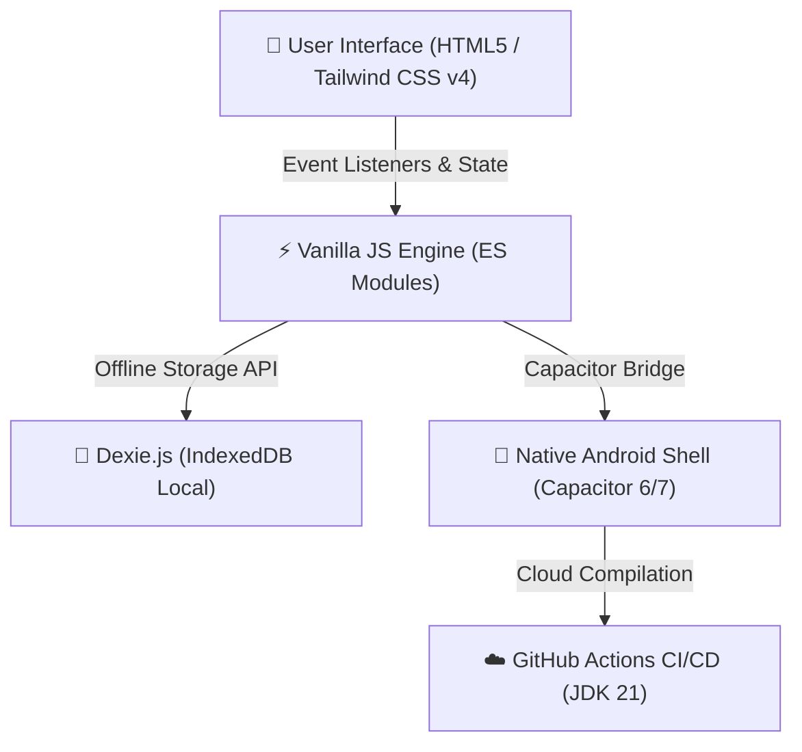
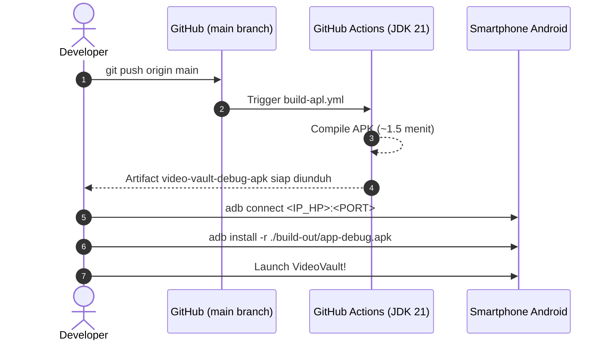

# 🎬 VideoVault — Premium Offline Video Vault for Android

<p align="center">
  
  
  
  
  
  
</p>

---

## 🌟 Tentang VideoVault

**VideoVault** adalah aplikasi bookmarking dan kurasi video personal mandiri (*standalone APK*) bertema **Deep Dark-Mode Premium** yang dirancang khusus untuk kenyamanan mobile satu tangan (*mobile-first ergonomic*). 

Aplikasi ini berjalan **100% offline tanpa server backend eksternal**, tanpa registrasi akun, dan tanpa pelacakan data. Seluruh data video, bookmark, kategori, dan metadata tersimpan secara permanen di memori lokal smartphone Anda menggunakan **IndexedDB (Dexie.js)**.

---

## ✨ Fitur Unggulan

### 🎨 1. Estetika Modern & Dark Mode Premium
- **Deep Zinc Palette (`#09090b`)**: Paduan latar belakang zinc gelap pekat dengan panel kartu `#121217` dan efek *ambient lighting* gradien indigo-violet yang elegan.
- **Glassmorphism Subtle**: Sentuhan border semi-transparan beraksen *inset highlight* tipis untuk ilusi kedalaman visual yang mewah.
- **Proporsi Card 16:9 Sinematik**: Thumbnail video proporsional dengan badge kategori mengambang (*frosted pill badge*) dan overlay tombol play interaktif saat ditekan atau disentuh.

### 📱 2. Ergonomi Mobile Ramah Jempol
- **Touch Target Nyaman (≥ 44×44px)**: Semua tombol aksi utama, filter, menu drop-down, dan bottom sheet mudah dijangkau dengan satu tangan tanpa salah ketuk.
- **Dukungan Penuh Safe-Area**: Kompatibel dengan area poni/kamera cut-out (`pt-safe`) serta navigation gesture bar Android terbaru (`pb-safe`).
- **Smooth Horizontal Category Bar**: Filter bar kategori dapat di-swipe mulus dari ujung ke ujung tanpa scrollbar yang mengganggu.

### ⚡ 3. Performa Ekstrem & 100% Offline-First
- **Tanpa Framework Berat**: Dibangun dengan **Vanilla JavaScript murni** dan Vite — waktu inisialisasi instan dan konsumsi RAM yang sangat minim.
- **Lokal & Mandiri**: Seluruh styling Tailwind CSS dikompilasi saat build-time tanpa memuat CDN runtime eksternal. Aplikasi tetap berfungsi normal bahkan dalam mode pesawat (*airplane mode*).
- **Dual Empty States**: Tampilan informatif khusus saat vault masih kosong maupun saat pencarian/filter tidak membuahkan hasil, lengkap dengan tombol reset instan.

### 🎥 4. Pemutar & Integrasi Fleksibel
- **YouTube Embed Player**: Pratinjau langsung video YouTube tanpa perlu keluar dari aplikasi.
- **HTML5 Direct Player**: Pemutar bawaan untuk file `.mp4`, `.webm`, `.mov`, dan link video langsung.
- **External Web Launcher**: Tautan fallback otomatis membuka browser eksternal untuk URL website standar.

---

## 🛠️ Arsitektur & Tech Stack



| Komponen | Teknologi | Keterangan |
| :--- | :--- | :--- |
| **Frontend Core** | Vanilla JavaScript (ESM) | Ringan, bebas *overhead*, pemeliharaan mudah |
| **Bundler & Tooling** | Vite 8+ | Hot Module Replacement (HMR) & build kilat (< 1s) |
| **Styling** | Tailwind CSS v4 | Build-time CSS lokal via `@tailwindcss/vite` |
| **Database Lokal** | Dexie.js v4 | Pembungkus IndexedDB berkemampuan query cepat |
| **Hybrid Bridge** | Capacitor Android | Bridge native Android untuk akses WebView mandiri |
| **Cloud CI/CD** | GitHub Actions (JDK 21) | Otomatisasi kompilasi `.apk` di cloud |

---

## 📂 Struktur Direktori Proyek

```text
video-vault/
├── .github/
│   └── workflows/
│       └── build-apl.yml       # Skrip CI/CD kompilasi APK di cloud (JDK 21)
├── android/                    # Proyek native Android (Capacitor)
│   └── app/src/main/
│       ├── AndroidManifest.xml # Izin native & orientasi Android
│       └── res/                # Ikon launcher & branding aplikasi
├── public/                     # Aset statis & logo
├── src/
│   ├── main.js                 # Logika Dexie.js, event handler, render card & UI
│   └── style.css               # Import Tailwind v4, safe-area & micro-animations
├── index.html                  # Shell antarmuka, bottom sheet & modal dialog
├── capacitor.config.json       # Konfigurasi appId: com.videovault.app
├── vite.config.js              # Konfigurasi bundler Vite + Tailwind
├── package.json                # Dependensi proyek
├── AGENTS.md                   # Dokumen ground-truth instruksi AI Agent
└── README.md                   # Dokumentasi resmi proyek ini
```

---

## 🚀 Panduan Pengembangan Lokal

### 1. Prasyarat
- **Node.js** v20+ atau versi LTS terbaru.
- **npm** atau **pnpm**.
- **Android Debug Bridge (`adb`)** untuk flashing via Wi-Fi (opsional).

### 2. Instalasi Dependensi
```bash
git clone https://github.com/YoriSyahputra/video-vault.git
cd video-vault
npm install
```

### 3. Menjalankan Server Pengembangan (Live Preview)
```bash
npm run dev
```
Buka browser di `http://localhost:5173` untuk melihat perubahan UI secara real-time.

### 4. Build & Sinkronisasi Android
Setiap kali selesai melakukan pengeditan antarmuka web:
```bash
npm run build
npx cap sync android
```

> [!IMPORTANT]
> **Batasan Perangkat:** Jangan pernah menjalankan kompilasi Gradle lokal (`./gradlew assembleDebug`) jika laptop memiliki keterbatasan spesifikasi. Seluruh kompilasi `.apk` ditangani otomatis oleh cloud CI/CD.

---

## 📦 Alur Rilis APK Cloud & Instalasi Nirkabel (Wireless ADB)

Aplikasi ini menggunakan alur otomatisasi modern tanpa perlu mencolokkan kabel data ke laptop.



### Langkah Instalasi ke HP Tanpa Kabel:

1. **Pairing Nirkabel (Hanya Sekali):**
   - Di HP: Buka **Pengaturan** > **Opsi Pengembang** > **Debugging Nirkabel** > **Pasangkan perangkat dengan kode**.
   - Di Terminal:
     ```bash
     adb pair <IP_HP>:<PORT_PAIRING>
     # Masukkan 6 digit kode pairing yang tampil di layar HP
     ```

2. **Koneksi:**
   ```bash
   adb connect <IP_HP>:<PORT_KONEKSI>
   adb devices
   ```

3. **Unduh APK Otomatis via GitHub CLI (`gh`):**
   ```bash
   gh run download -n video-vault-debug-apk -D ./build-out
   ```

4. **Flash APK Langsung ke HP:**
   ```bash
   adb install -r ./build-out/app-debug.apk
   adb shell monkey -p com.videovault.app -c android.intent.category.LAUNCHER 1
   ```

---

## 🗄️ Format Skema Database (`VideoVaultDB`)

Skema IndexedDB dikelola secara terstruktur melalui Dexie.js:

```javascript
const db = new Dexie("VideoVaultDB");
db.version(1).stores({
  videos: "++id, title, url, category, createdAt"
});
```

- `id`: Auto-increment integer (Primary Key).
- `title`: Judul video / deskripsi.
- `url`: Tautan video (YouTube, MP4 langsung, atau tautan web).
- `thumbnail`: URL gambar thumbnail cover (opsional).
- `category`: Label pengelompokan kategori.
- `createdAt`: ISO 8601 timestamp pembuatan data.

---

## 📄 Lisensi & Kontribusi

Dilisensikan di bawah [MIT License](LICENSE). Dibuat dengan dedikasi untuk performa, estetika dark mode, dan privasi penuh di perangkat Android Anda.
