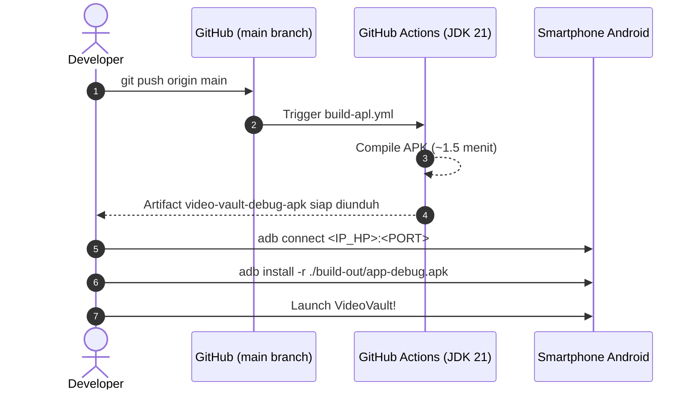

# 🎬 VideoVault — Luxury Offline Video & Notes Vault for Android

<p align="center">
  
  
  
  
  
  
  
</p>

---

## 🌟 Tentang VideoVault

**VideoVault** adalah aplikasi kurasi video personal dan catatan pribadi mandiri (*standalone APK*) bertema **Apple Liquid Glass & Dark Luxury (Obsidian-Mocha-Army Emerald)** yang dirancang khusus untuk kenyamanan mobile satu tangan (*mobile-first ergonomic*). 

Aplikasi ini berjalan **100% offline tanpa server backend eksternal**, tanpa registrasi akun, dan tanpa pelacakan data. Seluruh koleksi video, bookmark, kategori, serta catatan teks pribadi Anda tersimpan permanen di memori lokal smartphone menggunakan **IndexedDB (Dexie.js v2)**.

---

## ✨ Fitur Unggulan

### 💎 1. Desain Apple "Liquid Glass" 1:1 & Palet Mewah
- **Palet Stealth Mewah**: Paduan latar belakang terdalam **Deep Obsidian Onyx** (`#070709`), panel permukaan **Warm Dark Espresso/Mocha** (`#161311`), aksen kontras mencolok **Tactical Military / Army Emerald Green** (`#22c55e` / `#4ade80`), dan sentuhan **Champagne Gold**.
- **Liquid Glassmorphism 1:1**: Efek kaca cair multi-layer ultra-soft (`backdrop-blur-28px`), rim highlight specular 1px putih tipis di tepi kartu, serta inner ambient lighting layaknya antarmuka visionOS / iOS modern.
- **Header Action Protection**: Tombol aksi utama `+` ditempatkan elegan di **Header Navbar atas** berdampingan dengan tombol Sort, menjamin 100% bebas dari risiko terpotong batas bawah layar atau navigation gesture bar HP.

### 🪐 2. Animasi 3D Realistic Cinematic Vault Intro
- **Realistic 3D Perspective**: Begitu aplikasi dibuka, pengguna disambut oleh intro 3D emblem vault holografik yang berputar dengan depth perspective (`perspective: 1200px`), sapuan cahaya metallic sheen, dan gelombang shockwave Army Emerald.
- **Seamless Dissolve & Tap-to-Skip**: Bertransisi halus zoom-in ke dashboard utama dalam 1.8 detik, atau cukup ketuk layar kapan saja untuk masuk seketika.

### 📝 3. Fitur "Vault Notes" (Catatan Pribadi In-App ala Google Keep)
- **Modul Catatan Terintegrasi**: Tersedia navigasi segmented switch `[ 🎬 Video ]` dan `[ 📝 Catatan ]` di bagian atas aplikasi.
- **Penyimpanan Catatan 100% Offline**: Tulis, baca, cari, edit, dan kelola catatan bebas langsung di dalam aplikasi layaknya Google Keep pribadi Anda.
- **Auto-Capture saat Import Massal**: Saat mengimpor teks catatan yang berisi campuran link dan kalimat teks, seluruh kalimat non-link otomatis diekstrak dan disimpan sebagai catatan baru di tab Catatan!

### 🧹 4. Smart Notes & Glued Links Parser
- **Pemisahan Link Menempel**: Menangani teks berantakan dari catatan (seperti `.https://...https://...` tanpa spasi) secara otomatis dan akurat.
- **Pembersih Teks Menempel di URL**: Memotong teks judul yang nempel langsung di ujung slash URL dan memilahnya menjadi tautan bersih serta catatan teks pendamping.

### 🌐 5. Kategori Otomatis Berdasarkan Domain Web (*Auto-Domain Category*)
- **Deteksi Cerdas**: Aplikasi otomatis mengenali domain URL dan langsung menjadikannya kategori default tanpa perlu diketik manual (misal: tautan dari website video tertentu otomatis berkategori nama website tersebut).
- **1-Tap Save di Wizard**: Kategori domain otomatis terisi dan tersorot di wizard batch; pengguna cukup 1 ketukan untuk konfirmasi simpan seketika.

### ⚡ 6. Auto-Scraper Metadata (CORS-Free di Android)
- **Ekstraksi Otomatis**: Judul asli dan cover thumbnail otomatis diambil menggunakan parser **OpenGraph, Twitter Card, dan oEmbed** via `@capacitor/core` (`CapacitorHttp`) yang menembus CORS di native Android.
- **Smart URL Slug Fallback**: Jika suatu halaman video terblokir oleh jaringan ISP, sistem otomatis mengekstrak judul langsung dari slug path URL sehingga data video tidak pernah kosong.

### 🎥 7. Pemutar Video Terintegrasi Multi-Platform
- **Universal Embedded Player**: Mendukung pemutaran iframe resmi untuk berbagai platform video terkemuka di dalam aplikasi.
- **HTML5 Direct Player**: Pemutar video bawaan untuk file `.mp4`, `.webm`, `.mov`, dan streaming langsung.
- **External Web Launcher**: Tautan fallback otomatis membuka browser eksternal dalam 1 ketukan untuk URL website umum.

---

## 🛠️ Arsitektur & Tech Stack

```mermaid
graph TD
    A["📱 User Interface (Apple Liquid Glass / Tailwind CSS v4)"] -->|Event Listeners & State| B["⚡ Vanilla JS Engine (ES Modules)"]
    B -->|Offline Storage API (v2)| C["💾 Dexie.js (videos + notes)"]
    B -->|CapacitorHttp CORS Bypass| D["🌐 Metadata Scraper & Smart Notes Parser"]
    B -->|Capacitor Bridge| E["🤖 Native Android Shell (Capacitor 6/7)"]
    E -->|Cloud Compilation| F["☁️ GitHub Actions CI/CD (JDK 21)"]
```

| Komponen | Teknologi | Keterangan |
| :--- | :--- | :--- |
| **Frontend Core** | Vanilla JavaScript (ESM) | Ringan, bebas *overhead*, pemeliharaan mudah |
| **Styling & Theme** | Tailwind CSS v4 + Liquid Glass | Deep Obsidian, Mocha & Army Emerald Theme |
| **Database Lokal** | Dexie.js v2 (IndexedDB) | Store `videos` & Store `notes` 100% offline |
| **Hybrid Bridge & HTTP** | Capacitor Android + CapacitorHttp | Bridge native Android & HTTP bypass CORS |
| **Cloud CI/CD** | GitHub Actions (JDK 21) | Otomatisasi kompilasi `.apk` di cloud |

---

## 📂 Struktur Direktori Proyek

```text
video-vault/
├── .github/
│   └── workflows/
│       └── build-apl.yml       # Skrip CI/CD kompilasi APK di cloud (JDK 21)
├── android/                    # Proyek native Android (Capacitor)
│   └── app/src/main/
│       ├── AndroidManifest.xml # Izin native & orientasi Android
│       └── res/                # Ikon launcher & branding aplikasi
├── public/                     # Aset statis & logo
├── src/
│   ├── main.js                 # Logika Dexie v2, scraper, notes, wizard & UI
│   └── style.css               # Apple Liquid Glass, 3D intro & micro-animations
├── index.html                  # Shell antarmuka, 3D intro, notes modal & player
├── capacitor.config.json       # Konfigurasi appId & plugin CapacitorHttp
├── vite.config.js              # Konfigurasi bundler Vite + Tailwind
├── package.json                # Dependensi proyek
├── AGENTS.md                   # Dokumen ground-truth instruksi AI Agent
└── README.md                   # Dokumentasi resmi proyek ini
```

---

## 🚀 Panduan Pengembangan Lokal

### 1. Prasyarat
- **Node.js** v20+ atau versi LTS terbaru.
- **npm** atau **pnpm**.
- **Android Debug Bridge (`adb`)** untuk flashing via Wi-Fi (opsional).

### 2. Instalasi Dependensi
```bash
git clone https://github.com/YoriSyahputra/video-vault.git
cd video-vault
npm install
```

### 3. Menjalankan Server Pengembangan (Live Preview)
```bash
npm run dev
```
Buka browser di `http://localhost:5173` untuk melihat perubahan UI secara real-time.

### 4. Build & Sinkronisasi Android
Setiap kali selesai melakukan pengeditan antarmuka web:
```bash
npm run build
npx cap sync android
```

> [!IMPORTANT]
> **Batasan Perangkat:** Jangan pernah menjalankan kompilasi Gradle lokal (`./gradlew assembleDebug`) jika laptop memiliki keterbatasan spesifikasi. Seluruh kompilasi `.apk` ditangani otomatis oleh cloud CI/CD.

---

## 📦 Alur Rilis APK Cloud & Instalasi Nirkabel (Wireless ADB)

Aplikasi ini menggunakan alur otomatisasi modern tanpa perlu mencolokkan kabel data ke laptop.



### Langkah Instalasi ke HP Tanpa Kabel:

1. **Pairing Nirkabel (Hanya Sekali):**
   - Di HP: Buka **Pengaturan** > **Opsi Pengembang** > **Debugging Nirkabel** > **Pasangkan perangkat dengan kode**.
   - Di Terminal:
     ```bash
     adb pair <IP_HP>:<PORT_PAIRING>
     # Masukkan 6 digit kode pairing yang tampil di layar HP
     ```

2. **Koneksi:**
   ```bash
   adb connect <IP_HP>:<PORT_KONEKSI>
   adb devices
   ```

3. **Unduh APK Otomatis via GitHub CLI (`gh`):**
   ```bash
   gh run download -n video-vault-debug-apk -D ./build-out
   ```

4. **Flash APK Langsung ke HP:**
   ```bash
   adb install -r ./build-out/app-debug.apk
   adb shell monkey -p com.videovault.app -c android.intent.category.LAUNCHER 1
   ```

---

## 🗄️ Format Skema Database Dexie.js v2 (`VideoVaultDB`)

Skema IndexedDB dikelola secara terstruktur melalui Dexie.js versi 2:

```javascript
const db = new Dexie("VideoVaultDB");
db.version(1).stores({
  videos: "++id, title, url, category, createdAt"
});
db.version(2).stores({
  videos: "++id, title, url, category, createdAt",
  notes: "++id, title, content, createdAt, updatedAt"
});
```

### Store `videos`:
- `id`: Auto-increment integer (Primary Key).
- `title`: Judul video / deskripsi.
- `url`: Tautan video.
- `thumbnail`: URL cover thumbnail video.
- `category`: Label kategori (otomatis dari domain web atau kustom).
- `createdAt`: ISO 8601 timestamp pembuatan.

### Store `notes`:
- `id`: Auto-increment integer (Primary Key).
- `title`: Judul catatan pribadi.
- `content`: Teks isi catatan lengkap.
- `createdAt`: ISO 8601 timestamp pembuatan.
- `updatedAt`: ISO 8601 timestamp terakhir disunting.

---

## 📄 Lisensi & Kontribusi

Dilisensikan di bawah [MIT License](LICENSE). Dibuat dengan dedikasi untuk estetika Apple Liquid Glass, performa tanpa lag, dan privasi penuh di perangkat Android Anda.
